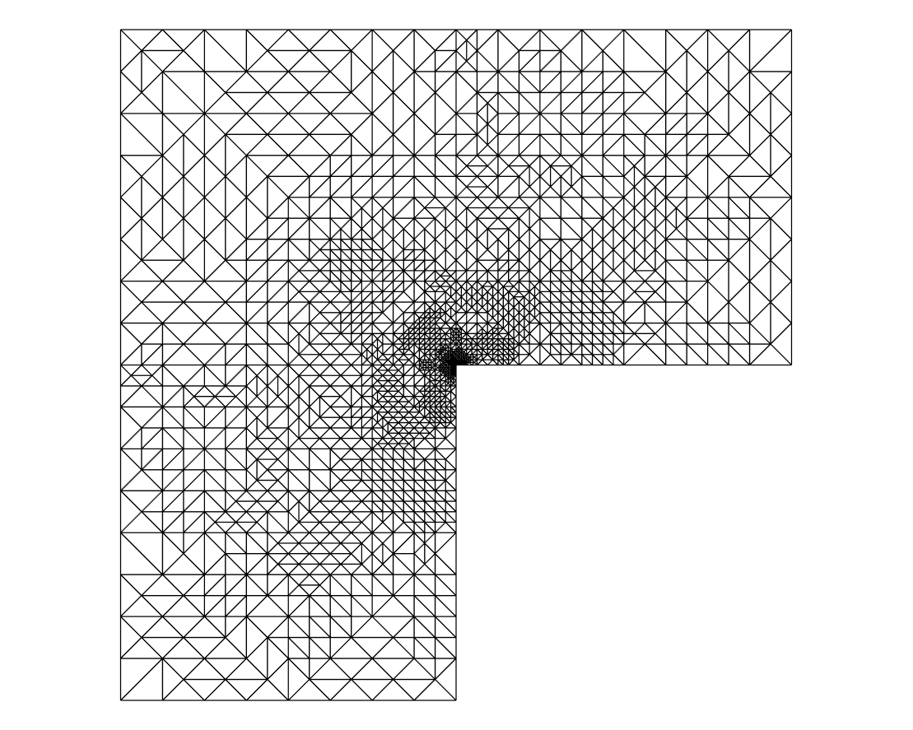
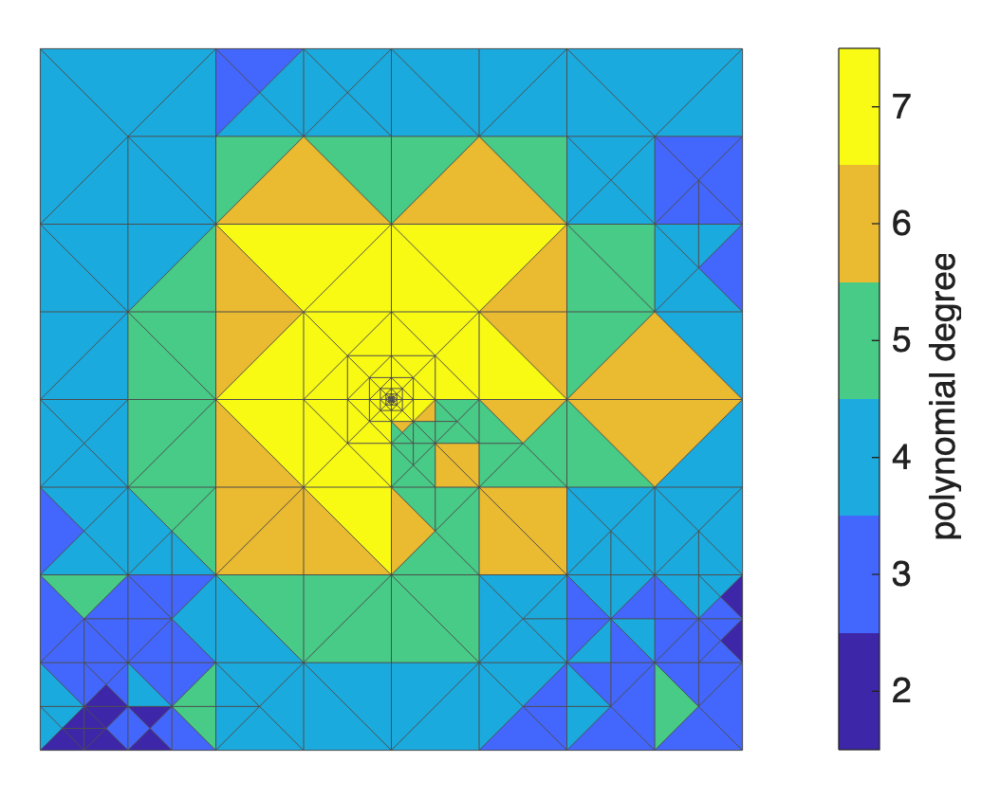
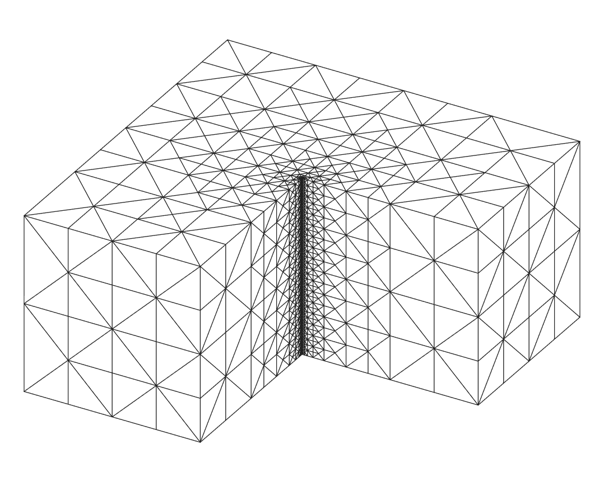
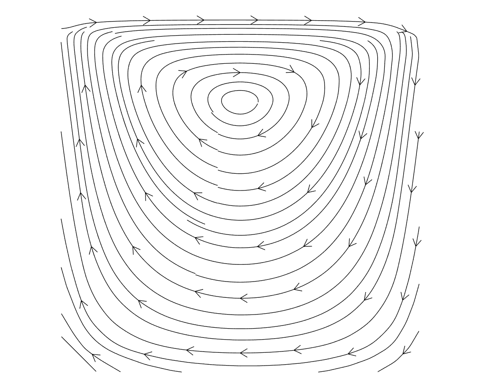
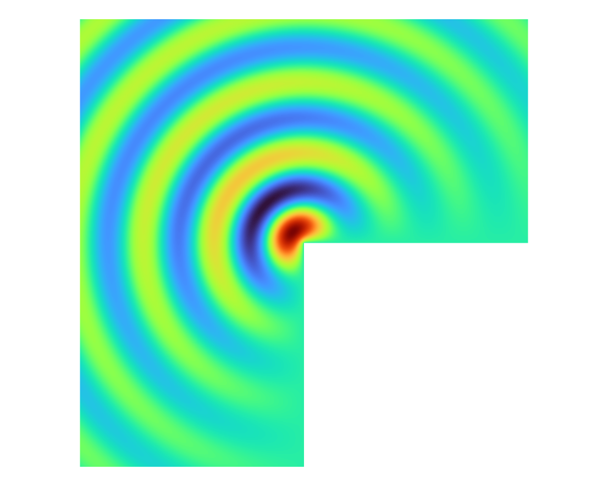
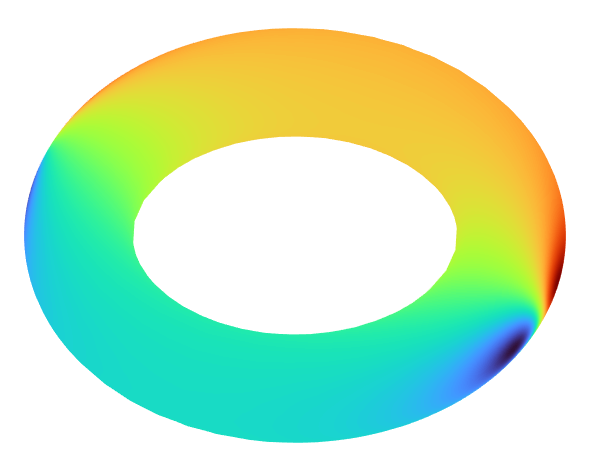

<p align="center">
  
</p>

<h1 align="center">fem4m</h1>

<p align="center">
  <b>A Finite Element Toolbox for MATLAB</b>
</p>

<p align="center">
  
  
  
  <a href="https://doi.org/10.5281/zenodo.23810422"></a>
</p>

<p align="center">
  <a href="#why-fem4m">Why fem4m</a> ·
  <a href="#gallery">Gallery</a> ·
  <a href="#quick-start">Quick start</a> ·
  <a href="#features">Features</a> ·
  <a href="#examples">Examples</a> ·
  <a href="#documentation-and-tests">Documentation</a>
</p>

---

**fem4m** is a MATLAB toolbox for finite element methods in research and teaching. Weak forms are written as strings that read like the integrals they stand for, so a new discretization, error estimator or error norm is a single line. Behind the strings sit the finite element classes (Lagrange, hp, Crouzeix-Raviart, discontinuous Galerkin, Raviart-Thomas, Brezzi-Douglas-Marini, Nédélec, Argyris, Hellan-Herrmann-Johnson, Arnold-Winther, ...), adaptive meshes in 2D, 3D and on surfaces, multigrid and domain decomposition solvers, and several ready-made test problems, most of them with exact solutions.

## Why fem4m

The integrals of a finite element method go into the code as they are:

```matlab
a   = BilinearForm('grad(u) * grad(v) dx');              % ∫ ∇u·∇v dx
l   = LinearForm('f(x) v dx + g(x) v dsn');              % ∫ f v dx + ∫ g v ds on Γ_N
eta = EstimatorForm(['h^2*(f(x)+div(grad(u)))^2 dx', ... % element residuals
                     '+ h^1*([grad(u)*n])^2 dsi']);      % normal jumps across edges
```

Jumps `[u]`, averages `{u}`, normals `n`, mesh sizes `h` and integrals over elements (`dx`), interior sides (`dsi`) and boundary parts (`dsd`, `dsn`) make discontinuous Galerkin methods just as short, here the symmetric interior penalty method:

```matlab
a = BilinearForm(['grad(u)*grad(v) dx', ...
    ' - [u]*n.{grad(v)} ds - {grad(u)}.[v]*n ds', ...
    ' + h^-1*alpha(x)*[u][v] ds']);
A = a.assemble(DGPk(2,mesh),'alpha',12);
```

The same form strings assemble matrices, load vectors, error norms and local error indicators, for every element of the toolbox.

## Gallery

<table>
  <tr>
    <td align="center" width="33%"><a href="toolbox/examples/exPoissonPkAdaptive.m"></a><br><sub><b>Adaptive refinement</b> towards the reentrant corner of the L-shaped domain</sub></td>
    <td align="center" width="33%"><a href="toolbox/examples/exPoissonHPAdaptive.m"></a><br><sub><b>hp-adaptivity</b>: local mesh size and polynomial degree on the slit domain</sub></td>
    <td align="center" width="33%"><a href="toolbox/examples/exPoisson3dPkAdaptive.m"></a><br><sub><b>3D</b>: newest vertex bisection along the reentrant edge</sub></td>
  </tr>
  <tr>
    <td align="center"><a href="toolbox/examples/exStokesTaylorHood.m"></a><br><sub><b>Stokes flow</b>: Taylor-Hood elements, here for the lid-driven cavity</sub></td>
    <td align="center"><a href="toolbox/examples/exHelmholtzPkAdaptive.m"></a><br><sub><b>Helmholtz</b>: waves from the reentrant corner, impedance boundary condition</sub></td>
    <td align="center"><a href="toolbox/examples/exLaplaceBeltramiPkAdaptive.m"></a><br><sub><b>Surface PDEs</b>: the Laplace-Beltrami problem on a torus</sub></td>
  </tr>
</table>

## Quick start

**1. Install.** Clone the repository and add the toolbox to the MATLAB path:

```matlab
addpath(genpath('fem4m/toolbox'));
```

or call `fem4mPath.addpath()` from `fem4m/toolbox/internal`, which adds all folders of the repository except those that start with a dot.

**2. Solve.** The Poisson problem −Δu = f on the unit square with P<sub>1</sub> elements on a sequence of uniformly refined meshes:

```matlab
p = problemScalarEllipticSquareExact();        % problem data and exact solution
mesh = Mesh(p.geom);                           % coarse mesh of the unit square
mesh = mesh.refine('uniform');
for lvl = 1:6
    fe = Pk(1,mesh);                           % P1 finite element space
    a = BilinearForm('grad(u) * grad(v) dx');
    A = a.assemble(fe);                        % stiffness matrix
    l = LinearForm('f(x) v dx');
    b = l.assemble(fe,'f',@p.f);               % load vector
    x = zeros(fe.nrDoF,1);
    free = fe.freeNodes;                       % u = 0 on the boundary
    x(free) = A(free,free)\b(free);
    h1 = ErrorForm('( exact(x) - grad(u) )^2 dx');
    disp(h1.assemble(x,fe,'exact',@p.exactGradU))  % error in the energy norm
    mesh = mesh.refine('uniform');
end
```

**3. Learn.** Open [`toolbox/examples/exPoissonP1.m`](toolbox/examples/exPoissonP1.m) in MATLAB and follow the [examples](#examples).

<details>
<summary><b>An adaptive finite element method in 25 lines</b></summary>

```matlab
p = problemScalarEllipticLshapeExact();        % singular solution on the L-shape
mesh = Mesh(p.geom);
mark = MarkBulk;                               % Dörfler marking
while true
    % SOLVE
    fe = Pk(2,mesh);
    A = BilinearForm('grad(u) * grad(v) dx').assemble(fe);
    b = LinearForm('f(x) v dx + g(x) v dsn').assemble(fe,'f',@p.f,'g',@(x,n)p.g(x,n));
    x = zeros(fe.nrDoF,1);
    x(fe.fixedNodes) = p.u4Db(fe.c4dof(fe.fixedNodes,:));
    b = b - A*x;
    free = fe.freeNodes;
    x(free) = A(free,free)\b(free);
    % ESTIMATE
    eta = EstimatorForm(['h^2*(f(x)+div(grad(u)))^2 dx', ...
        '+ h^1*([grad(u)*n])^2 dsi + h^1*(g(x)-grad(u)*n)^2 dsn']);
    eta4e = eta.assemble(x,fe,'f',@p.f,'g',@(x,n)p.g(x,n));
    if fe.nrDoF >= 1e4, break, end
    % MARK and REFINE
    mark = mark.mark(fe,eta4e);
    mesh = mesh.refine(mark.marked4ed);
end
plot(mesh);
```

</details>

## Features

| Feature | Description |
|---|---|
| **Forms** | `BilinearForm`, `LinearForm`, `ErrorForm` and `EstimatorForm` parse form strings with gradients, divergence, `rot`/`curl`, symmetric gradients, Hessians, jumps, averages, normals, tangents and coefficient functions; integrals over elements, interior sides and boundary parts |
| **Elements** | Lagrange P<sub>k</sub> in 2D and 3D, hp-elements with a degree per element, Crouzeix-Raviart, DG spaces (Lagrange, Dubiner, scaled monomials, on polygons), Raviart-Thomas and Brezzi-Douglas-Marini in 2D and 3D (also hybridized), Nédélec of both kinds in 2D and 3D, Argyris and TUBA for H<sup>2</sup>, Hellan-Herrmann-Johnson, Arnold-Winther, Hu-Zhang and further elasticity elements, bubbles, vector- and matrix-valued compositions |
| **Meshes** | triangular meshes with red-green-blue or newest vertex bisection refinement and coarsening, tetrahedral meshes with recursive bisection, triangulated surfaces in 3D, polygonal meshes; built-in domains such as the square, L-shape, slit, disk and cube with one boundary condition per boundary part |
| **Adaptivity** | residual-based estimators written as form strings; bulk (Dörfler), maximum, mean, fixed-fraction and hp marking |
| **Solvers** | geometric multigrid; additive and multiplicative Schwarz preconditioners (hierarchical basis, BPX, vertex patches, BPS, Neumann-Neumann, BDDC); primal-dual active set method for obstacle problems; preconditioned inverse iteration for eigenvalue problems |
| **Problems** | 128 problem classes for Poisson and scalar elliptic, biharmonic, elasticity, Stokes, Maxwell, Helmholtz, eigenvalue, obstacle, transport, vector Laplace and surface problems, most with exact solutions |
| **Documentation** | reference pages, overviews and the examples in the MATLAB Help browser, with full-text search |

## Examples

The 31 examples in [`toolbox/examples`](toolbox/examples) are tutorials. Each one states the problem and its weak formulation, derives the discretization, relates every integral to its form string, runs a convergence study or an adaptive loop, discusses the observed rates, and ends with suggestions for your own experiments. They are plain-text live scripts: open one in MATLAB to run it step by step.

Start with the basics and follow the branch you are interested in:

| Topic | Examples |
|---|---|
| **Basics** | [mesh data](toolbox/examples/exMeshEnumeration.m) · [basis functions](toolbox/examples/exElementBasisFunctions.m) · [P<sub>1</sub> for the Poisson problem](toolbox/examples/exPoissonP1.m) |
| **Adaptivity** | [P<sub>k</sub>](toolbox/examples/exPoissonPkAdaptive.m) · [hp](toolbox/examples/exPoissonHPAdaptive.m) · [Crouzeix-Raviart](toolbox/examples/exEllipticCRAdaptive.m) · [3D](toolbox/examples/exPoisson3dPkAdaptive.m) · [surfaces](toolbox/examples/exLaplaceBeltramiPkAdaptive.m) |
| **Mixed methods** | [an unstable pair](toolbox/examples/exPoissonMixedP1P0Unstable.m) · [Raviart-Thomas](toolbox/examples/exPoissonRTAdaptive.m) |
| **Discontinuous Galerkin** | [SIPG](toolbox/examples/exPoissonDG.m) · [adaptive SIPG](toolbox/examples/exPoissonDGAdaptive.m) · [LDG](toolbox/examples/exPoissonLDG.m) · [mixed DG](toolbox/examples/exPoissonMixedDG.m) · [HDG](toolbox/examples/exPoissonHDG.m) |
| **Eigenvalues** | [Laplacian](toolbox/examples/exEigenvaluePkAdaptive.m) · [anisotropic diffusion](toolbox/examples/exEigenvalueDiffusionPkAdaptive.m) |
| **Elasticity** | [adaptive P<sub>k</sub>](toolbox/examples/exElasticityPkAdaptive.m) · [Arnold-Winther](toolbox/examples/exElasticityAW.m) |
| **Stokes** | [Taylor-Hood](toolbox/examples/exStokesTaylorHood.m) · [DG](toolbox/examples/exStokesDG.m) |
| **Plates** | [Argyris](toolbox/examples/exBiharmonicArgyris.m) · [Hellan-Herrmann-Johnson](toolbox/examples/exBiharmonicHHJ.m) |
| **Waves** | [Maxwell with Nédélec elements](toolbox/examples/exMaxwellNd.m) · [Helmholtz](toolbox/examples/exHelmholtzPkAdaptive.m) |
| **More** | [obstacle problem](toolbox/examples/exObstacleP1Adaptive.m) · [transport with upwind DG](toolbox/examples/exTransportDG.m) |
| **Solvers** | [smoothing](toolbox/examples/exSolverSmoothing.m) · [two-grid](toolbox/examples/exSolverTwoGrid.m) · [multigrid](toolbox/examples/exSolverMultigrid.m) · [Schwarz preconditioners](toolbox/examples/exSolverSchwarz.m) |

## Documentation and tests

The documentation for the MATLAB Help browser is generated from the help texts and the examples. Build it from the repository folder with

```matlab
buildtool docs        % reference pages, overviews, example pages and search index (runs all examples)
buildtool pages       % only the reference and overview pages, in a few seconds
```

The pages appear in the MATLAB Help browser, under Supplemental Software, as soon as `toolbox` is on the path. `buildtool package` builds the documentation, runs the tests and packages the toolbox as `release/fem4m-<version>.mltbx`.

The test suite in [`tests`](tests) checks the elements, forms and solvers with patch tests (exact reproduction of polynomial solutions), convergence tests and unit tests:

```matlab
buildtool test
```

## Repository layout

| Folder | Content |
|---|---|
| [`toolbox`](toolbox) | the toolbox: `elements`, `forms`, `mesh`, `geometries`, `problems`, `solve`, `internal` and the `examples` |
| [`tests`](tests) | the test suite (`matlab.unittest`) |
| [`docbuild`](docbuild) | the documentation generator and the overview pages |

## Requirements

MATLAB R2026a or newer. fem4m uses only core MATLAB, no further toolboxes.

## Citing fem4m

If you use fem4m in your research, please cite it (see also [`CITATION.cff`](CITATION.cff)):

```bibtex
@misc{fem4m,
  author       = {Gedicke, Joscha},
  title        = {fem4m: A Finite Element Toolbox for {MATLAB}},
  year         = {2026},
  version      = {1.0},
  doi          = {10.5281/zenodo.23810422},
  howpublished = {\url{https://github.com/fem4m/fem4m}}
}
```

## License

fem4m is released under the [MIT License](LICENSE). Copyright (c) 2026 by the [fem4m authors](AUTHORS).
